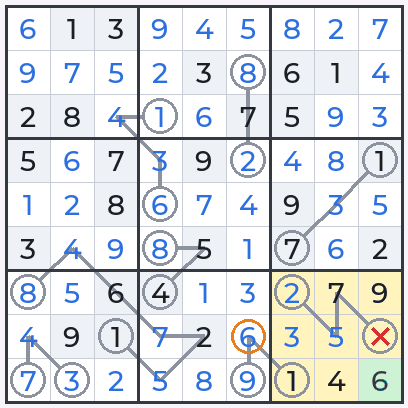

<!-- Written by tools/walkthrough.py between-lines: edit the script, not this page. -->
# Between Lines, step 52: the 6 in box 9

**Step 52 of 53** · [← Step 51](step-51.md) · [All steps](../between-lines.md#the-whole-puzzle-step-by-step) · [Step 53 →](step-53.md)

Box 9 needs a 6. r8c9: row 8 has one (r8c6). Only **r9c9** is left: **r9c9 = 6**.

**Step 52 of 53** · [← Step 51](step-51.md) · [All steps](../between-lines.md#the-whole-puzzle-step-by-step) · [Step 53 →](step-53.md)
