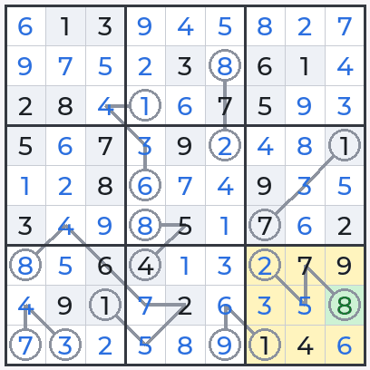

<!-- Written by tools/walkthrough.py between-lines: edit the script, not this page. -->
# Between Lines, step 53: the 8 in box 9

**Step 53 of 53** · [← Step 52](step-52.md) · [All steps](../between-lines.md#the-whole-puzzle-step-by-step) · [All steps](../between-lines.md#the-whole-puzzle-step-by-step)

Box 9 needs an 8, and r8c9 is its last empty cell: **r8c9 = 8**.

Solved.

**Step 53 of 53** · [← Step 52](step-52.md) · [All steps](../between-lines.md#the-whole-puzzle-step-by-step) · [All steps](../between-lines.md#the-whole-puzzle-step-by-step)
