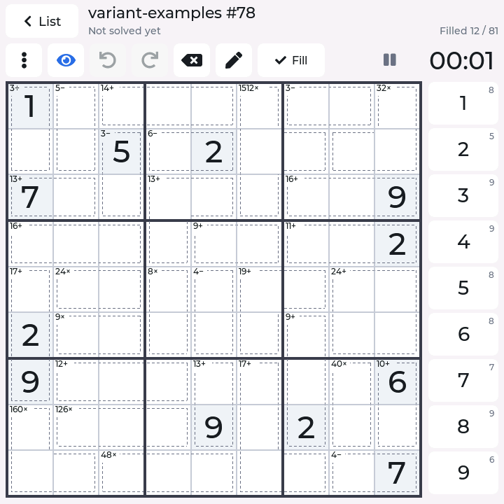
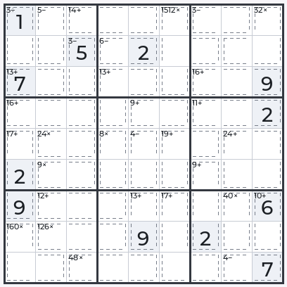

# Calcudoku Killer

[← All variants](README.md) · [Puzzles](../features-puzzles.md) · [How to play](../how-to-play.md)

## The rules

[Classic](classic.md) rules, plus **cages** (dashed outlines), each with a number and a sign in its corner, and no digit repeats in a cage:

- **+**: the cage's digits **add up** to the number, as in [Killer](killer.md);
- **×**: they **multiply** to it, as in [Product Killer](product-killer.md);
- **−** (two-cell cages only): its two digits are **that far apart**: 5− is 1 and 6, 2 and 7, 3 and 8 or 4 and 9;
- **÷** (two-cell cages only): the larger is **that many times** the smaller: 3÷ is 1 and 3, 2 and 6 or 3 and 9.

## On the board

- Cages are drawn as in Killer, with the number and its sign in the top-left corner ("12×", "5−").
- A cage turns red when its digits can't make its number: over the sum, a digit that doesn't divide the product, or a full − or ÷ pair that's wrong.
- The grader and hints work out each cage: "The cage at row 1, column 1 holds two digits, one 3 times the other: with what's in it and around it, its empty cells can only be 3."
- **Puzzles → ⋮ → New puzzle → Clues → Calcudoku**, at all four levels. Easy and Medium cages are 2 or 3 cells, Hard and Expert up to 5. A two-cell cage gets any of the four signs (÷ only where one digit divides the other), a bigger one + or ×.

## How to solve it

- **− and ÷ cages are short lists:** 8− is 1 and 9; 4÷ is 1 and 4 or 2 and 8; 7− is 1 and 8 or 2 and 9. A large difference or quotient pins the pair down at once.
- **A digit no partner fits is out:** in a 5− cage there's no 5 (nothing is 5 away from it); in a 3÷ cage only 1, 2, 3, 6 and 9 can go.
- **Use + and × cages as in Killer and Product Killer:** small sums and prime factors narrow the digits.

## Worked example

**variant-examples #78**, Calcudoku Killer Easy (see [Classic](classic.md#worked-example-the-whole-puzzle) for how to import the examples; cells are written r*row*c*column*). It has only eight givens: the cages do the work.

**Step 1: the 9 in row 9.** r9c1 to r9c3 see the 9 in r7c1, r9c4 to r9c6 the one in r8c5; r9c9 holds a 7. r9c8 is in a **4−** cage with that 7: its partner would be 3, not 9. Only **r9c7** is left: **r9c7 = 9**.

**Step 2: r2c1.** It shares a **3÷** cage with the 1 in r1c1, so it's 3 (3 times 1; nothing is a third of 1). **r2c1 = 3**.

**Step 3: r3c2.** It shares a **13+** cage with the 7 in r3c1, so it's 6. **r3c2 = 6**.

## The whole puzzle, step by step

<!-- walkthrough -->
<!-- Written by tools/walkthrough.py calcudoku-killer: edit the script, not this part. -->

The whole puzzle, from the start to the last cell: 69 steps, each one a single (one place left for a digit, or one digit left for a cell), taken in the order a box's single comes first, so not quite the order of the worked example above. Each step has a page of its own, with **Previous** and **Next**: pick its number below. In each picture, the unit the step looks at is tinted yellow (for a cell with one digit left: its row, column and box), the new digit is on green, the digits that rule cells out have an **orange ring**, and the empty cells they rule out a **red cross**. Givens are on grey, digits from earlier steps in blue.

| [1](calcudoku-killer/step-01.md) | [2](calcudoku-killer/step-02.md) | [3](calcudoku-killer/step-03.md) | [4](calcudoku-killer/step-04.md) | [5](calcudoku-killer/step-05.md) | [6](calcudoku-killer/step-06.md) | [7](calcudoku-killer/step-07.md) | [8](calcudoku-killer/step-08.md) | [9](calcudoku-killer/step-09.md) | [10](calcudoku-killer/step-10.md) |
|:-:|:-:|:-:|:-:|:-:|:-:|:-:|:-:|:-:|:-:|
| [11](calcudoku-killer/step-11.md) | [12](calcudoku-killer/step-12.md) | [13](calcudoku-killer/step-13.md) | [14](calcudoku-killer/step-14.md) | [15](calcudoku-killer/step-15.md) | [16](calcudoku-killer/step-16.md) | [17](calcudoku-killer/step-17.md) | [18](calcudoku-killer/step-18.md) | [19](calcudoku-killer/step-19.md) | [20](calcudoku-killer/step-20.md) |
| [21](calcudoku-killer/step-21.md) | [22](calcudoku-killer/step-22.md) | [23](calcudoku-killer/step-23.md) | [24](calcudoku-killer/step-24.md) | [25](calcudoku-killer/step-25.md) | [26](calcudoku-killer/step-26.md) | [27](calcudoku-killer/step-27.md) | [28](calcudoku-killer/step-28.md) | [29](calcudoku-killer/step-29.md) | [30](calcudoku-killer/step-30.md) |
| [31](calcudoku-killer/step-31.md) | [32](calcudoku-killer/step-32.md) | [33](calcudoku-killer/step-33.md) | [34](calcudoku-killer/step-34.md) | [35](calcudoku-killer/step-35.md) | [36](calcudoku-killer/step-36.md) | [37](calcudoku-killer/step-37.md) | [38](calcudoku-killer/step-38.md) | [39](calcudoku-killer/step-39.md) | [40](calcudoku-killer/step-40.md) |
| [41](calcudoku-killer/step-41.md) | [42](calcudoku-killer/step-42.md) | [43](calcudoku-killer/step-43.md) | [44](calcudoku-killer/step-44.md) | [45](calcudoku-killer/step-45.md) | [46](calcudoku-killer/step-46.md) | [47](calcudoku-killer/step-47.md) | [48](calcudoku-killer/step-48.md) | [49](calcudoku-killer/step-49.md) | [50](calcudoku-killer/step-50.md) |
| [51](calcudoku-killer/step-51.md) | [52](calcudoku-killer/step-52.md) | [53](calcudoku-killer/step-53.md) | [54](calcudoku-killer/step-54.md) | [55](calcudoku-killer/step-55.md) | [56](calcudoku-killer/step-56.md) | [57](calcudoku-killer/step-57.md) | [58](calcudoku-killer/step-58.md) | [59](calcudoku-killer/step-59.md) | [60](calcudoku-killer/step-60.md) |
| [61](calcudoku-killer/step-61.md) | [62](calcudoku-killer/step-62.md) | [63](calcudoku-killer/step-63.md) | [64](calcudoku-killer/step-64.md) | [65](calcudoku-killer/step-65.md) | [66](calcudoku-killer/step-66.md) | [67](calcudoku-killer/step-67.md) | [68](calcudoku-killer/step-68.md) | [69](calcudoku-killer/step-69.md) |  |

Solved.

<!-- /walkthrough -->
