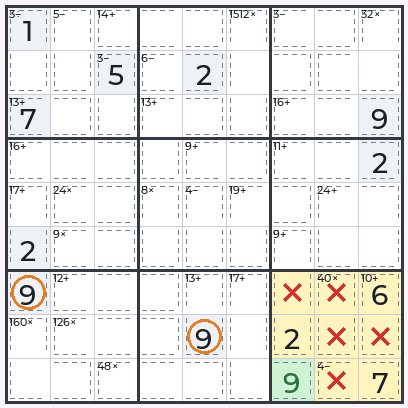

<!-- Written by tools/walkthrough.py calcudoku-killer: edit the script, not this page. -->
# Calcudoku Killer, step 1: the 9 in box 9

**Step 1 of 69** · [← The start](../calcudoku-killer.md#the-whole-puzzle-step-by-step) · [All steps](../calcudoku-killer.md#the-whole-puzzle-step-by-step) · [Step 2 →](step-02.md)

Box 9 needs a 9. r7c7 and r7c8: row 7 has one (r7c1). r8c8 and r8c9: row 8 has one (r8c5). r9c8: in the 4− cage the other digit is 7, and 9 isn't 4 apart from it. Only **r9c7** is left: **r9c7 = 9**.

**Step 1 of 69** · [← The start](../calcudoku-killer.md#the-whole-puzzle-step-by-step) · [All steps](../calcudoku-killer.md#the-whole-puzzle-step-by-step) · [Step 2 →](step-02.md)
