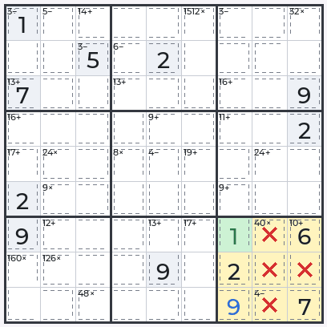

<!-- Written by tools/walkthrough.py calcudoku-killer: edit the script, not this page. -->
# Calcudoku Killer, step 2: the 1 in box 9

**Step 2 of 69** · [← Step 1](step-01.md) · [All steps](../calcudoku-killer.md#the-whole-puzzle-step-by-step) · [Step 3 →](step-03.md)

Box 9 needs a 1. r7c8 and r8c8: in the 40× cage, a 1 would leave 40 for its other cell, which different digits can't make. r8c9: the 10+ cage (with 6 already in it) needs 4 there. r9c8: in the 4− cage the other digit is 7, and 1 isn't 4 apart from it. Only **r7c7** is left: **r7c7 = 1**.

**Step 2 of 69** · [← Step 1](step-01.md) · [All steps](../calcudoku-killer.md#the-whole-puzzle-step-by-step) · [Step 3 →](step-03.md)
