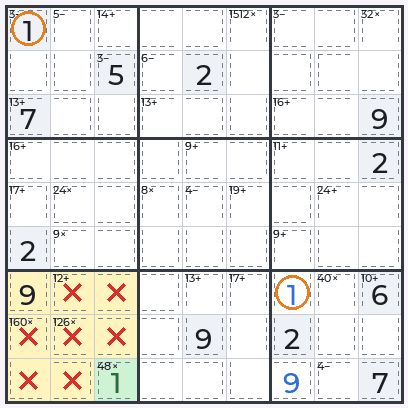

<!-- Written by tools/walkthrough.py calcudoku-killer: edit the script, not this page. -->
# Calcudoku Killer, step 3: the 1 in box 7

**Step 3 of 69** · [← Step 2](step-02.md) · [All steps](../calcudoku-killer.md#the-whole-puzzle-step-by-step) · [Step 4 →](step-04.md)

Box 7 needs a 1. r7c2 and r7c3: row 7 has one (r7c7). r8c1 and r9c1: column 1 has one (r1c1). r8c2 and r8c3: in the 126× cage, a 1 would leave 126 for its other 2 cells, which different digits can't make. r9c2: in the 160× cage, a 1 would leave 160 for its other 2 cells, which different digits can't make. Only **r9c3** is left: **r9c3 = 1**.

**Step 3 of 69** · [← Step 2](step-02.md) · [All steps](../calcudoku-killer.md#the-whole-puzzle-step-by-step) · [Step 4 →](step-04.md)
