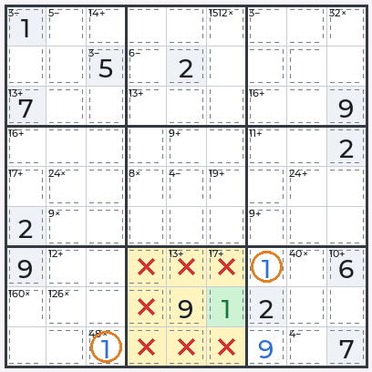

<!-- Written by tools/walkthrough.py calcudoku-killer: edit the script, not this page. -->
# Calcudoku Killer, step 4: the 1 in box 8

**Step 4 of 69** · [← Step 3](step-03.md) · [All steps](../calcudoku-killer.md#the-whole-puzzle-step-by-step) · [Step 5 →](step-05.md)

Box 8 needs a 1. r7c4, r7c5 and r7c6: row 7 has one (r7c7). r9c4, r9c5 and r9c6: row 9 has one (r9c3). r8c4: in the 126× cage, a 1 would leave 126 for its other 2 cells, which different digits can't make. Only **r8c6** is left: **r8c6 = 1**.

**Step 4 of 69** · [← Step 3](step-03.md) · [All steps](../calcudoku-killer.md#the-whole-puzzle-step-by-step) · [Step 5 →](step-05.md)
