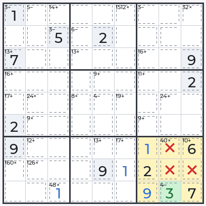

<!-- Written by tools/walkthrough.py calcudoku-killer: edit the script, not this page. -->
# Calcudoku Killer, step 5: the 3 in box 9

**Step 5 of 69** · [← Step 4](step-04.md) · [All steps](../calcudoku-killer.md#the-whole-puzzle-step-by-step) · [Step 6 →](step-06.md)

Box 9 needs a 3. r7c8 and r8c8: the cage's digits multiply to 40, and 3 doesn't go into it. r8c9: the 10+ cage (with 6 already in it) needs 4 there. Only **r9c8** is left: **r9c8 = 3**.

**Step 5 of 69** · [← Step 4](step-04.md) · [All steps](../calcudoku-killer.md#the-whole-puzzle-step-by-step) · [Step 6 →](step-06.md)
