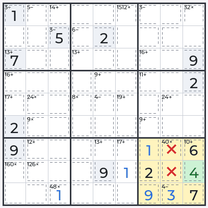

<!-- Written by tools/walkthrough.py calcudoku-killer: edit the script, not this page. -->
# Calcudoku Killer, step 6: the 4 in box 9

**Step 6 of 69** · [← Step 5](step-05.md) · [All steps](../calcudoku-killer.md#the-whole-puzzle-step-by-step) · [Step 7 →](step-07.md)

Box 9 needs a 4. r7c8 and r8c8: in the 40× cage, a 4 would leave 10 for its other cell, which different digits can't make. Only **r8c9** is left: **r8c9 = 4**.

**Step 6 of 69** · [← Step 5](step-05.md) · [All steps](../calcudoku-killer.md#the-whole-puzzle-step-by-step) · [Step 7 →](step-07.md)
