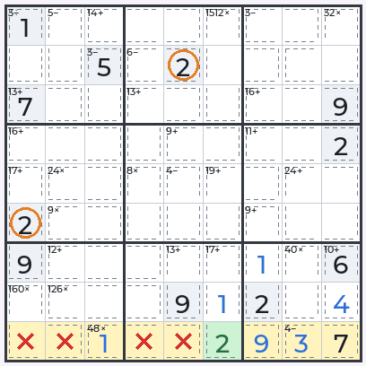

<!-- Written by tools/walkthrough.py calcudoku-killer: edit the script, not this page. -->
# Calcudoku Killer, step 7: the 2 in row 9

**Step 7 of 69** · [← Step 6](step-06.md) · [All steps](../calcudoku-killer.md#the-whole-puzzle-step-by-step) · [Step 8 →](step-08.md)

Row 9 needs a 2. r9c1: column 1 has one (r6c1). r9c5: column 5 has one (r2c5). r9c2: in the 160× cage, a 2 would leave 80 for its other 2 cells, which different digits can't make. r9c4: in the 48× cage (with 1 already in it), a 2 would leave 24 for its other cell, which different digits can't make. Only **r9c6** is left: **r9c6 = 2**.

**Step 7 of 69** · [← Step 6](step-06.md) · [All steps](../calcudoku-killer.md#the-whole-puzzle-step-by-step) · [Step 8 →](step-08.md)
