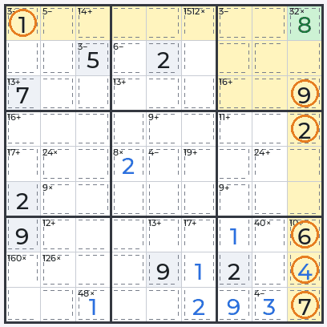

<!-- Written by tools/walkthrough.py calcudoku-killer: edit the script, not this page. -->
# Calcudoku Killer, step 9: r1c9

**Step 9 of 69** · [← Step 8](step-08.md) · [All steps](../calcudoku-killer.md#the-whole-puzzle-step-by-step) · [Step 10 →](step-10.md)

Row 1 has 1; column 9 has 2, 4, 6, 7 and 9. Not 3: the cage's digits multiply to 32, and 3 doesn't go into it. Not 5: the cage's digits multiply to 32, and 5 doesn't go into it. Only 8 is left: **r1c9 = 8**.

**Step 9 of 69** · [← Step 8](step-08.md) · [All steps](../calcudoku-killer.md#the-whole-puzzle-step-by-step) · [Step 10 →](step-10.md)
