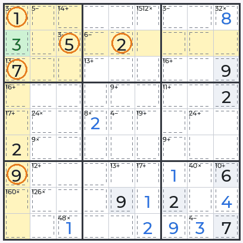

<!-- Written by tools/walkthrough.py calcudoku-killer: edit the script, not this page. -->
# Calcudoku Killer, step 10: r2c1

**Step 10 of 69** · [← Step 9](step-09.md) · [All steps](../calcudoku-killer.md#the-whole-puzzle-step-by-step) · [Step 11 →](step-11.md)

Column 1 has 1, 7 and 9; row 2 has 2 and 5. Not 4: in the 3÷ cage the other digit is 1, and 4 isn't 3 times it or a third of it. Not 6: in the 3÷ cage the other digit is 1, and 6 isn't 3 times it or a third of it. Not 8: in the 3÷ cage the other digit is 1, and 8 isn't 3 times it or a third of it. Only 3 is left: **r2c1 = 3**.

**Step 10 of 69** · [← Step 9](step-09.md) · [All steps](../calcudoku-killer.md#the-whole-puzzle-step-by-step) · [Step 11 →](step-11.md)
