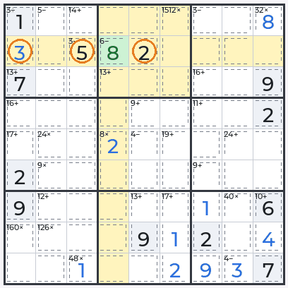

<!-- Written by tools/walkthrough.py calcudoku-killer: edit the script, not this page. -->
# Calcudoku Killer, step 11: r2c4

**Step 11 of 69** · [← Step 10](step-10.md) · [All steps](../calcudoku-killer.md#the-whole-puzzle-step-by-step) · [Step 12 →](step-12.md)

Row 2 has 2, 3 and 5. Not 1: in the 6− cage the other digit is 2, and 1 isn't 6 apart from it. Not 4: in the 6− cage the other digit is 2, and 4 isn't 6 apart from it. Not 6: in the 6− cage the other digit is 2, and 6 isn't 6 apart from it. Not 7: in the 6− cage the other digit is 2, and 7 isn't 6 apart from it. Not 9: in the 6− cage the other digit is 2, and 9 isn't 6 apart from it. Only 8 is left: **r2c4 = 8**.

**Step 11 of 69** · [← Step 10](step-10.md) · [All steps](../calcudoku-killer.md#the-whole-puzzle-step-by-step) · [Step 12 →](step-12.md)
