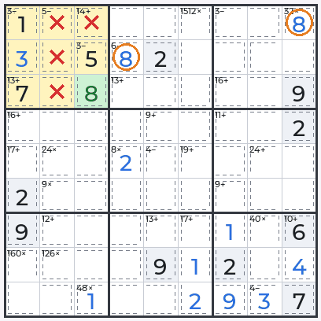

<!-- Written by tools/walkthrough.py calcudoku-killer: edit the script, not this page. -->
# Calcudoku Killer, step 12: the 8 in box 1

**Step 12 of 69** · [← Step 11](step-11.md) · [All steps](../calcudoku-killer.md#the-whole-puzzle-step-by-step) · [Step 13 →](step-13.md)

Box 1 needs an 8. r1c2 and r1c3: row 1 has one (r1c9). r2c2: row 2 has one (r2c4). r3c2: the 13+ cage (with 7 already in it) needs 6 there. Only **r3c3** is left: **r3c3 = 8**.

**Step 12 of 69** · [← Step 11](step-11.md) · [All steps](../calcudoku-killer.md#the-whole-puzzle-step-by-step) · [Step 13 →](step-13.md)
