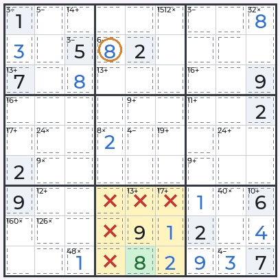

<!-- Written by tools/walkthrough.py calcudoku-killer: edit the script, not this page. -->
# Calcudoku Killer, step 13: the 8 in box 8

**Step 13 of 69** · [← Step 12](step-12.md) · [All steps](../calcudoku-killer.md#the-whole-puzzle-step-by-step) · [Step 14 →](step-14.md)

Box 8 needs an 8. r7c4, r8c4 and r9c4: column 4 has one (r2c4). r7c5: the 13+ cage (with 9 already in it) needs 4 there. r7c6: the 17+ cage (with 1, 2 and 9 already in it) needs 5 there. Only **r9c5** is left: **r9c5 = 8**.

**Step 13 of 69** · [← Step 12](step-12.md) · [All steps](../calcudoku-killer.md#the-whole-puzzle-step-by-step) · [Step 14 →](step-14.md)
