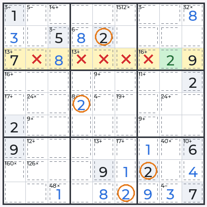

<!-- Written by tools/walkthrough.py calcudoku-killer: edit the script, not this page. -->
# Calcudoku Killer, step 14: the 2 in row 3

**Step 14 of 69** · [← Step 13](step-13.md) · [All steps](../calcudoku-killer.md#the-whole-puzzle-step-by-step) · [Step 15 →](step-15.md)

Row 3 needs a 2. r3c4: column 4 has one (r5c4). r3c5: column 5 has one (r2c5). r3c6: column 6 has one (r9c6). r3c7: column 7 has one (r8c7). r3c2: the 13+ cage (with 7 already in it) needs 6 there. Only **r3c8** is left: **r3c8 = 2**.

**Step 14 of 69** · [← Step 13](step-13.md) · [All steps](../calcudoku-killer.md#the-whole-puzzle-step-by-step) · [Step 15 →](step-15.md)
