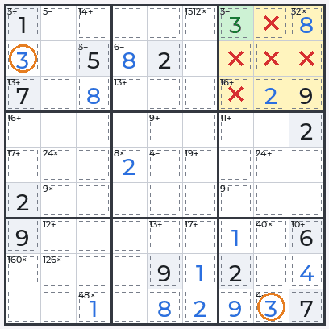

<!-- Written by tools/walkthrough.py calcudoku-killer: edit the script, not this page. -->
# Calcudoku Killer, step 15: the 3 in box 3

**Step 15 of 69** · [← Step 14](step-14.md) · [All steps](../calcudoku-killer.md#the-whole-puzzle-step-by-step) · [Step 16 →](step-16.md)

Box 3 needs a 3. r1c8: column 8 has one (r9c8). r2c7, r2c8 and r2c9: row 2 has one (r2c1). r3c7: the 16+ cage (with 2 and 9 already in it) needs 5 there. Only **r1c7** is left: **r1c7 = 3**.

**Step 15 of 69** · [← Step 14](step-14.md) · [All steps](../calcudoku-killer.md#the-whole-puzzle-step-by-step) · [Step 16 →](step-16.md)
