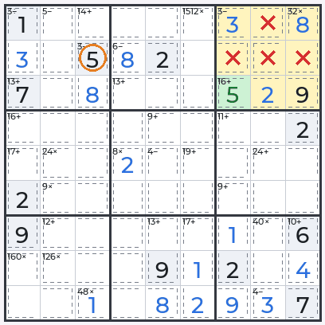

<!-- Written by tools/walkthrough.py calcudoku-killer: edit the script, not this page. -->
# Calcudoku Killer, step 16: the 5 in box 3

**Step 16 of 69** · [← Step 15](step-15.md) · [All steps](../calcudoku-killer.md#the-whole-puzzle-step-by-step) · [Step 17 →](step-17.md)

Box 3 needs a 5. r2c7, r2c8 and r2c9: row 2 has one (r2c3). r1c8: in the 3− cage the other digit is 3, and 5 isn't 3 apart from it. Only **r3c7** is left: **r3c7 = 5**.

**Step 16 of 69** · [← Step 15](step-15.md) · [All steps](../calcudoku-killer.md#the-whole-puzzle-step-by-step) · [Step 17 →](step-17.md)
