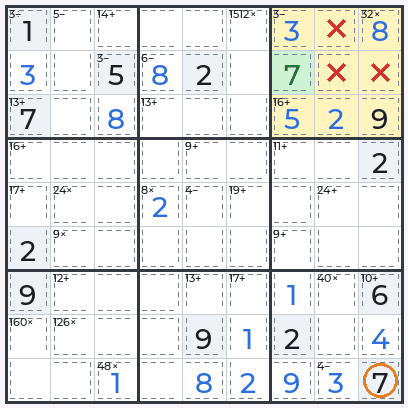

<!-- Written by tools/walkthrough.py calcudoku-killer: edit the script, not this page. -->
# Calcudoku Killer, step 17: the 7 in box 3

**Step 17 of 69** · [← Step 16](step-16.md) · [All steps](../calcudoku-killer.md#the-whole-puzzle-step-by-step) · [Step 18 →](step-18.md)

Box 3 needs a 7. r2c9: column 9 has one (r9c9). r1c8: in the 3− cage the other digit is 3, and 7 isn't 3 apart from it. r2c8: the 32× cage (with 8 already in it) leaves 4 to make, and 7 doesn't go into it. Only **r2c7** is left: **r2c7 = 7**.

**Step 17 of 69** · [← Step 16](step-16.md) · [All steps](../calcudoku-killer.md#the-whole-puzzle-step-by-step) · [Step 18 →](step-18.md)
