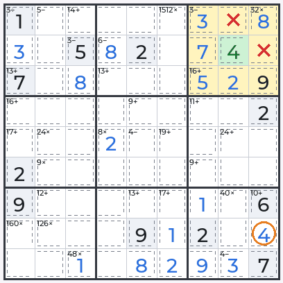

<!-- Written by tools/walkthrough.py calcudoku-killer: edit the script, not this page. -->
# Calcudoku Killer, step 18: the 4 in box 3

**Step 18 of 69** · [← Step 17](step-17.md) · [All steps](../calcudoku-killer.md#the-whole-puzzle-step-by-step) · [Step 19 →](step-19.md)

Box 3 needs a 4. r2c9: column 9 has one (r8c9). r1c8: in the 3− cage the other digit is 3, and 4 isn't 3 apart from it. Only **r2c8** is left: **r2c8 = 4**.

**Step 18 of 69** · [← Step 17](step-17.md) · [All steps](../calcudoku-killer.md#the-whole-puzzle-step-by-step) · [Step 19 →](step-19.md)
