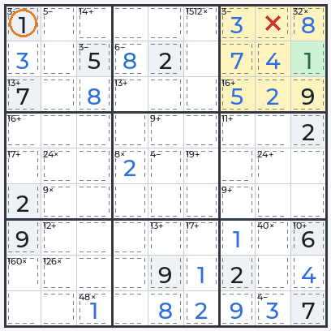

<!-- Written by tools/walkthrough.py calcudoku-killer: edit the script, not this page. -->
# Calcudoku Killer, step 19: the 1 in box 3

**Step 19 of 69** · [← Step 18](step-18.md) · [All steps](../calcudoku-killer.md#the-whole-puzzle-step-by-step) · [Step 20 →](step-20.md)

Box 3 needs a 1. r1c8: row 1 has one (r1c1). Only **r2c9** is left: **r2c9 = 1**.

**Step 19 of 69** · [← Step 18](step-18.md) · [All steps](../calcudoku-killer.md#the-whole-puzzle-step-by-step) · [Step 20 →](step-20.md)
