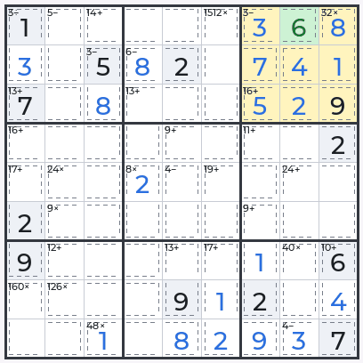

<!-- Written by tools/walkthrough.py calcudoku-killer: edit the script, not this page. -->
# Calcudoku Killer, step 20: the 6 in box 3

**Step 20 of 69** · [← Step 19](step-19.md) · [All steps](../calcudoku-killer.md#the-whole-puzzle-step-by-step) · [Step 21 →](step-21.md)

Box 3 needs a 6, and r1c8 is its last empty cell: **r1c8 = 6**.

**Step 20 of 69** · [← Step 19](step-19.md) · [All steps](../calcudoku-killer.md#the-whole-puzzle-step-by-step) · [Step 21 →](step-21.md)
