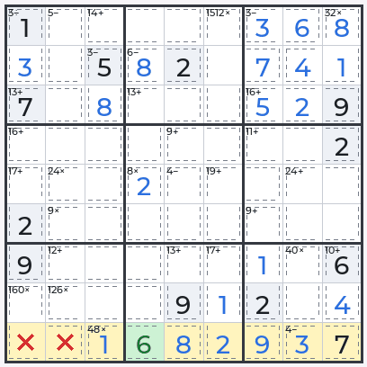

<!-- Written by tools/walkthrough.py calcudoku-killer: edit the script, not this page. -->
# Calcudoku Killer, step 21: the 6 in row 9

**Step 21 of 69** · [← Step 20](step-20.md) · [All steps](../calcudoku-killer.md#the-whole-puzzle-step-by-step) · [Step 22 →](step-22.md)

Row 9 needs a 6. r9c1 and r9c2: the cage's digits multiply to 160, and 6 doesn't go into it. Only **r9c4** is left: **r9c4 = 6**.

**Step 21 of 69** · [← Step 20](step-20.md) · [All steps](../calcudoku-killer.md#the-whole-puzzle-step-by-step) · [Step 22 →](step-22.md)
