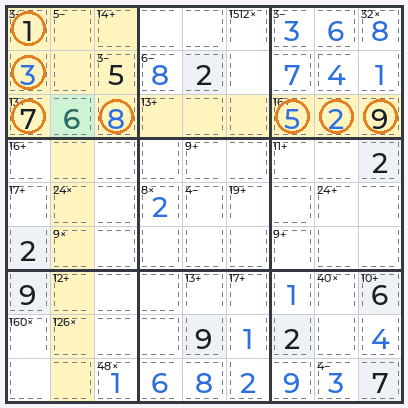

<!-- Written by tools/walkthrough.py calcudoku-killer: edit the script, not this page. -->
# Calcudoku Killer, step 22: r3c2

**Step 22 of 69** · [← Step 21](step-21.md) · [All steps](../calcudoku-killer.md#the-whole-puzzle-step-by-step) · [Step 23 →](step-23.md)

Box 1 has 1 and 3; row 3 has 2, 5, 7, 8 and 9. Not 4: the 13+ cage (with 7 already in it) needs 6 there. Only 6 is left: **r3c2 = 6**.

**Step 22 of 69** · [← Step 21](step-21.md) · [All steps](../calcudoku-killer.md#the-whole-puzzle-step-by-step) · [Step 23 →](step-23.md)
