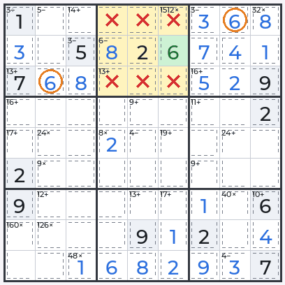

<!-- Written by tools/walkthrough.py calcudoku-killer: edit the script, not this page. -->
# Calcudoku Killer, step 23: the 6 in box 2

**Step 23 of 69** · [← Step 22](step-22.md) · [All steps](../calcudoku-killer.md#the-whole-puzzle-step-by-step) · [Step 24 →](step-24.md)

Box 2 needs a 6. r1c4, r1c5 and r1c6: row 1 has one (r1c8). r3c4, r3c5 and r3c6: row 3 has one (r3c2). Only **r2c6** is left: **r2c6 = 6**.

**Step 23 of 69** · [← Step 22](step-22.md) · [All steps](../calcudoku-killer.md#the-whole-puzzle-step-by-step) · [Step 24 →](step-24.md)
