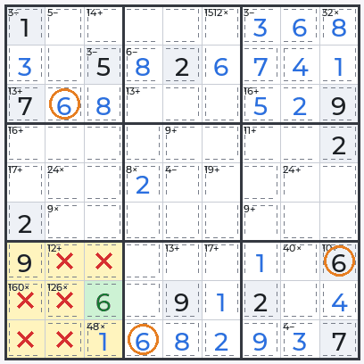

<!-- Written by tools/walkthrough.py calcudoku-killer: edit the script, not this page. -->
# Calcudoku Killer, step 24: the 6 in box 7

**Step 24 of 69** · [← Step 23](step-23.md) · [All steps](../calcudoku-killer.md#the-whole-puzzle-step-by-step) · [Step 25 →](step-25.md)

Box 7 needs a 6. r7c2 and r7c3: row 7 has one (r7c9). r8c2: column 2 has one (r3c2). r9c1 and r9c2: row 9 has one (r9c4). r8c1: the cage's digits multiply to 160, and 6 doesn't go into it. Only **r8c3** is left: **r8c3 = 6**.

**Step 24 of 69** · [← Step 23](step-23.md) · [All steps](../calcudoku-killer.md#the-whole-puzzle-step-by-step) · [Step 25 →](step-25.md)
