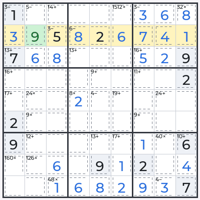

<!-- Written by tools/walkthrough.py calcudoku-killer: edit the script, not this page. -->
# Calcudoku Killer, step 25: the 9 in row 2

**Step 25 of 69** · [← Step 24](step-24.md) · [All steps](../calcudoku-killer.md#the-whole-puzzle-step-by-step) · [Step 26 →](step-26.md)

Row 2 needs a 9, and r2c2 is its last empty cell: **r2c2 = 9**.

**Step 25 of 69** · [← Step 24](step-24.md) · [All steps](../calcudoku-killer.md#the-whole-puzzle-step-by-step) · [Step 26 →](step-26.md)
