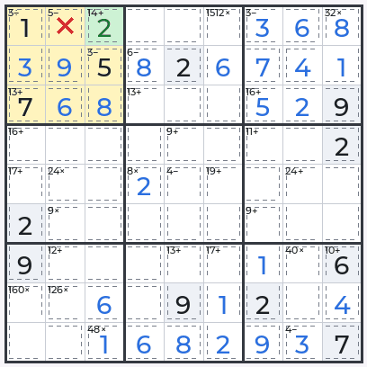

<!-- Written by tools/walkthrough.py calcudoku-killer: edit the script, not this page. -->
# Calcudoku Killer, step 26: the 2 in box 1

**Step 26 of 69** · [← Step 25](step-25.md) · [All steps](../calcudoku-killer.md#the-whole-puzzle-step-by-step) · [Step 27 →](step-27.md)

Box 1 needs a 2. r1c2: in the 5− cage the other digit is 9, and 2 isn't 5 apart from it. Only **r1c3** is left: **r1c3 = 2**.

**Step 26 of 69** · [← Step 25](step-25.md) · [All steps](../calcudoku-killer.md#the-whole-puzzle-step-by-step) · [Step 27 →](step-27.md)
