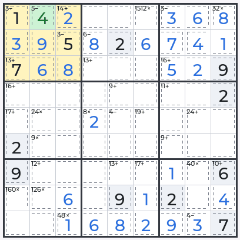

<!-- Written by tools/walkthrough.py calcudoku-killer: edit the script, not this page. -->
# Calcudoku Killer, step 27: the 4 in box 1

**Step 27 of 69** · [← Step 26](step-26.md) · [All steps](../calcudoku-killer.md#the-whole-puzzle-step-by-step) · [Step 28 →](step-28.md)

Box 1 needs a 4, and r1c2 is its last empty cell: **r1c2 = 4**.

**Step 27 of 69** · [← Step 26](step-26.md) · [All steps](../calcudoku-killer.md#the-whole-puzzle-step-by-step) · [Step 28 →](step-28.md)
