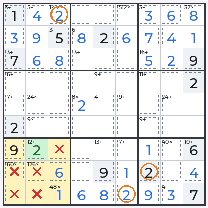

<!-- Written by tools/walkthrough.py calcudoku-killer: edit the script, not this page. -->
# Calcudoku Killer, step 28: the 2 in box 7

**Step 28 of 69** · [← Step 27](step-27.md) · [All steps](../calcudoku-killer.md#the-whole-puzzle-step-by-step) · [Step 29 →](step-29.md)

Box 7 needs a 2. r7c3: column 3 has one (r1c3). r8c1 and r8c2: row 8 has one (r8c7). r9c1 and r9c2: row 9 has one (r9c6). Only **r7c2** is left: **r7c2 = 2**.

**Step 28 of 69** · [← Step 27](step-27.md) · [All steps](../calcudoku-killer.md#the-whole-puzzle-step-by-step) · [Step 29 →](step-29.md)
