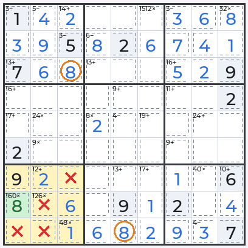

<!-- Written by tools/walkthrough.py calcudoku-killer: edit the script, not this page. -->
# Calcudoku Killer, step 29: the 8 in box 7

**Step 29 of 69** · [← Step 28](step-28.md) · [All steps](../calcudoku-killer.md#the-whole-puzzle-step-by-step) · [Step 30 →](step-30.md)

Box 7 needs an 8. r7c3: column 3 has one (r3c3). r9c1 and r9c2: row 9 has one (r9c5). r8c2: the 126× cage (with 6 already in it) leaves 21 to make, and 8 doesn't go into it. Only **r8c1** is left: **r8c1 = 8**.

**Step 29 of 69** · [← Step 28](step-28.md) · [All steps](../calcudoku-killer.md#the-whole-puzzle-step-by-step) · [Step 30 →](step-30.md)
