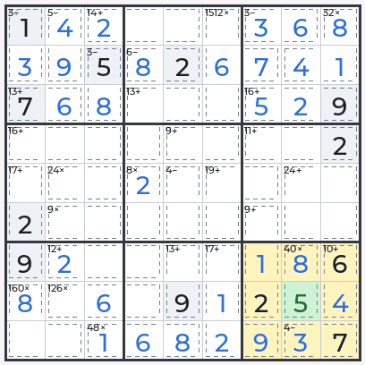

<!-- Written by tools/walkthrough.py calcudoku-killer: edit the script, not this page. -->
# Calcudoku Killer, step 31: the 5 in box 9

**Step 31 of 69** · [← Step 30](step-30.md) · [All steps](../calcudoku-killer.md#the-whole-puzzle-step-by-step) · [Step 32 →](step-32.md)

Box 9 needs a 5, and r8c8 is its last empty cell: **r8c8 = 5**.

**Step 31 of 69** · [← Step 30](step-30.md) · [All steps](../calcudoku-killer.md#the-whole-puzzle-step-by-step) · [Step 32 →](step-32.md)
