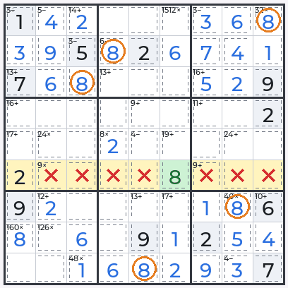

<!-- Written by tools/walkthrough.py calcudoku-killer: edit the script, not this page. -->
# Calcudoku Killer, step 32: the 8 in row 6

**Step 32 of 69** · [← Step 31](step-31.md) · [All steps](../calcudoku-killer.md#the-whole-puzzle-step-by-step) · [Step 33 →](step-33.md)

Row 6 needs an 8. r6c3: column 3 has one (r3c3). r6c4: column 4 has one (r2c4). r6c5: column 5 has one (r9c5). r6c8: column 8 has one (r7c8). r6c9: column 9 has one (r1c9). r6c2: the cage's digits multiply to 9, and 8 doesn't go into it. r6c7: the 9+ cage (with 1 and 2 already in it) needs 6 there. Only **r6c6** is left: **r6c6 = 8**.

**Step 32 of 69** · [← Step 31](step-31.md) · [All steps](../calcudoku-killer.md#the-whole-puzzle-step-by-step) · [Step 33 →](step-33.md)
