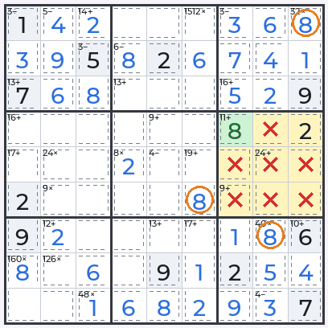

<!-- Written by tools/walkthrough.py calcudoku-killer: edit the script, not this page. -->
# Calcudoku Killer, step 33: the 8 in box 6

**Step 33 of 69** · [← Step 32](step-32.md) · [All steps](../calcudoku-killer.md#the-whole-puzzle-step-by-step) · [Step 34 →](step-34.md)

Box 6 needs an 8. r4c8 and r5c8: column 8 has one (r7c8). r5c9: column 9 has one (r1c9). r6c7, r6c8 and r6c9: row 6 has one (r6c6). r5c7: the 19+ cage (with 8 already in it) has a 8 already. Only **r4c7** is left: **r4c7 = 8**.

**Step 33 of 69** · [← Step 32](step-32.md) · [All steps](../calcudoku-killer.md#the-whole-puzzle-step-by-step) · [Step 34 →](step-34.md)
