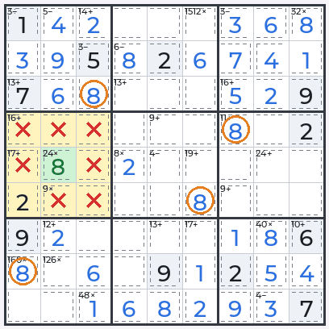

<!-- Written by tools/walkthrough.py calcudoku-killer: edit the script, not this page. -->
# Calcudoku Killer, step 34: the 8 in box 4

**Step 34 of 69** · [← Step 33](step-33.md) · [All steps](../calcudoku-killer.md#the-whole-puzzle-step-by-step) · [Step 35 →](step-35.md)

Box 4 needs an 8. r4c1, r4c2 and r4c3: row 4 has one (r4c7). r5c1: column 1 has one (r8c1). r5c3: column 3 has one (r3c3). r6c2 and r6c3: row 6 has one (r6c6). Only **r5c2** is left: **r5c2 = 8**.

**Step 34 of 69** · [← Step 33](step-33.md) · [All steps](../calcudoku-killer.md#the-whole-puzzle-step-by-step) · [Step 35 →](step-35.md)
