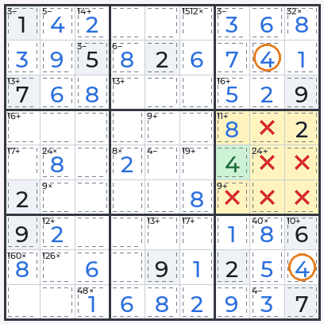

<!-- Written by tools/walkthrough.py calcudoku-killer: edit the script, not this page. -->
# Calcudoku Killer, step 35: the 4 in box 6

**Step 35 of 69** · [← Step 34](step-34.md) · [All steps](../calcudoku-killer.md#the-whole-puzzle-step-by-step) · [Step 36 →](step-36.md)

Box 6 needs a 4. r4c8, r5c8 and r6c8: column 8 has one (r2c8). r5c9 and r6c9: column 9 has one (r8c9). r6c7: the 9+ cage (with 1 and 2 already in it) needs 6 there. Only **r5c7** is left: **r5c7 = 4**.

**Step 35 of 69** · [← Step 34](step-34.md) · [All steps](../calcudoku-killer.md#the-whole-puzzle-step-by-step) · [Step 36 →](step-36.md)
