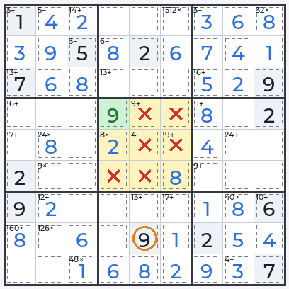

<!-- Written by tools/walkthrough.py calcudoku-killer: edit the script, not this page. -->
# Calcudoku Killer, step 36: the 9 in box 5

**Step 36 of 69** · [← Step 35](step-35.md) · [All steps](../calcudoku-killer.md#the-whole-puzzle-step-by-step) · [Step 37 →](step-37.md)

Box 5 needs a 9. r4c5, r5c5 and r6c5: column 5 has one (r8c5). r4c6: in the 9+ cage, a 9 would leave 0 for its other cell, too little. r5c6: the 19+ cage (with 4 and 8 already in it) needs 7 there. r6c4: the 8× cage (with 2 already in it) leaves 4 to make, and 9 doesn't go into it. Only **r4c4** is left: **r4c4 = 9**.

**Step 36 of 69** · [← Step 35](step-35.md) · [All steps](../calcudoku-killer.md#the-whole-puzzle-step-by-step) · [Step 37 →](step-37.md)
