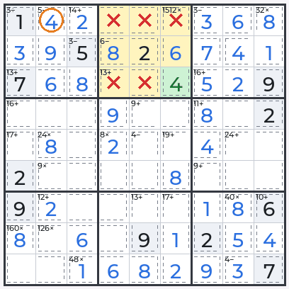

<!-- Written by tools/walkthrough.py calcudoku-killer: edit the script, not this page. -->
# Calcudoku Killer, step 37: the 4 in box 2

**Step 37 of 69** · [← Step 36](step-36.md) · [All steps](../calcudoku-killer.md#the-whole-puzzle-step-by-step) · [Step 38 →](step-38.md)

Box 2 needs a 4. r1c4, r1c5 and r1c6: row 1 has one (r1c2). r3c4 and r3c5: in the 13+ cage (with 9 already in it), a 4 would leave 0 for its other cell, too little. Only **r3c6** is left: **r3c6 = 4**.

**Step 37 of 69** · [← Step 36](step-36.md) · [All steps](../calcudoku-killer.md#the-whole-puzzle-step-by-step) · [Step 38 →](step-38.md)
