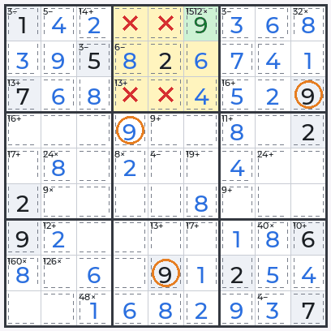

<!-- Written by tools/walkthrough.py calcudoku-killer: edit the script, not this page. -->
# Calcudoku Killer, step 38: the 9 in box 2

**Step 38 of 69** · [← Step 37](step-37.md) · [All steps](../calcudoku-killer.md#the-whole-puzzle-step-by-step) · [Step 39 →](step-39.md)

Box 2 needs a 9. r1c4: column 4 has one (r4c4). r1c5: column 5 has one (r8c5). r3c4 and r3c5: row 3 has one (r3c9). Only **r1c6** is left: **r1c6 = 9**.

**Step 38 of 69** · [← Step 37](step-37.md) · [All steps](../calcudoku-killer.md#the-whole-puzzle-step-by-step) · [Step 39 →](step-39.md)
