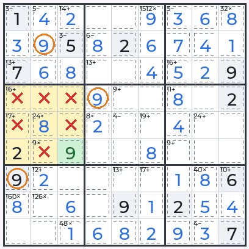

<!-- Written by tools/walkthrough.py calcudoku-killer: edit the script, not this page. -->
# Calcudoku Killer, step 39: the 9 in box 4

**Step 39 of 69** · [← Step 38](step-38.md) · [All steps](../calcudoku-killer.md#the-whole-puzzle-step-by-step) · [Step 40 →](step-40.md)

Box 4 needs a 9. r4c1, r4c2 and r4c3: row 4 has one (r4c4). r5c1: column 1 has one (r7c1). r6c2: column 2 has one (r2c2). r5c3: the 24× cage (with 8 already in it) leaves 3 to make, and 9 doesn't go into it. Only **r6c3** is left: **r6c3 = 9**.

**Step 39 of 69** · [← Step 38](step-38.md) · [All steps](../calcudoku-killer.md#the-whole-puzzle-step-by-step) · [Step 40 →](step-40.md)
