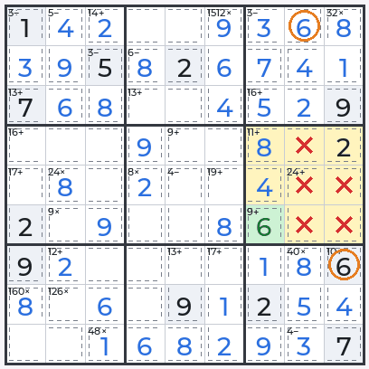

<!-- Written by tools/walkthrough.py calcudoku-killer: edit the script, not this page. -->
# Calcudoku Killer, step 40: the 6 in box 6

**Step 40 of 69** · [← Step 39](step-39.md) · [All steps](../calcudoku-killer.md#the-whole-puzzle-step-by-step) · [Step 41 →](step-41.md)

Box 6 needs a 6. r4c8, r5c8 and r6c8: column 8 has one (r1c8). r5c9 and r6c9: column 9 has one (r7c9). Only **r6c7** is left: **r6c7 = 6**.

**Step 40 of 69** · [← Step 39](step-39.md) · [All steps](../calcudoku-killer.md#the-whole-puzzle-step-by-step) · [Step 41 →](step-41.md)
