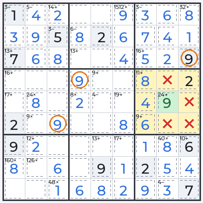

<!-- Written by tools/walkthrough.py calcudoku-killer: edit the script, not this page. -->
# Calcudoku Killer, step 41: the 9 in box 6

**Step 41 of 69** · [← Step 40](step-40.md) · [All steps](../calcudoku-killer.md#the-whole-puzzle-step-by-step) · [Step 42 →](step-42.md)

Box 6 needs a 9. r4c8: row 4 has one (r4c4). r5c9: column 9 has one (r3c9). r6c8 and r6c9: row 6 has one (r6c3). Only **r5c8** is left: **r5c8 = 9**.

**Step 41 of 69** · [← Step 40](step-40.md) · [All steps](../calcudoku-killer.md#the-whole-puzzle-step-by-step) · [Step 42 →](step-42.md)
