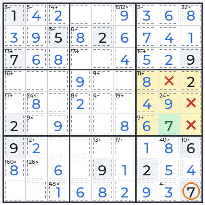

<!-- Written by tools/walkthrough.py calcudoku-killer: edit the script, not this page. -->
# Calcudoku Killer, step 42: the 7 in box 6

**Step 42 of 69** · [← Step 41](step-41.md) · [All steps](../calcudoku-killer.md#the-whole-puzzle-step-by-step) · [Step 43 →](step-43.md)

Box 6 needs a 7. r5c9 and r6c9: column 9 has one (r9c9). r4c8: the 11+ cage (with 8 and 2 already in it) needs 1 there. Only **r6c8** is left: **r6c8 = 7**.

**Step 42 of 69** · [← Step 41](step-41.md) · [All steps](../calcudoku-killer.md#the-whole-puzzle-step-by-step) · [Step 43 →](step-43.md)
