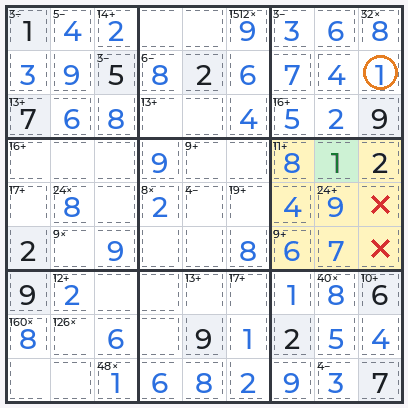

<!-- Written by tools/walkthrough.py calcudoku-killer: edit the script, not this page. -->
# Calcudoku Killer, step 43: the 1 in box 6

**Step 43 of 69** · [← Step 42](step-42.md) · [All steps](../calcudoku-killer.md#the-whole-puzzle-step-by-step) · [Step 44 →](step-44.md)

Box 6 needs a 1. r5c9 and r6c9: column 9 has one (r2c9). Only **r4c8** is left: **r4c8 = 1**.

**Step 43 of 69** · [← Step 42](step-42.md) · [All steps](../calcudoku-killer.md#the-whole-puzzle-step-by-step) · [Step 44 →](step-44.md)
