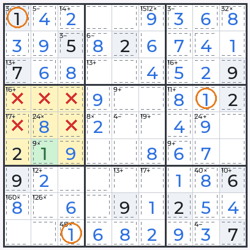

<!-- Written by tools/walkthrough.py calcudoku-killer: edit the script, not this page. -->
# Calcudoku Killer, step 44: the 1 in box 4

**Step 44 of 69** · [← Step 43](step-43.md) · [All steps](../calcudoku-killer.md#the-whole-puzzle-step-by-step) · [Step 45 →](step-45.md)

Box 4 needs a 1. r4c1, r4c2 and r4c3: row 4 has one (r4c8). r5c1: column 1 has one (r1c1). r5c3: column 3 has one (r9c3). Only **r6c2** is left: **r6c2 = 1**.

**Step 44 of 69** · [← Step 43](step-43.md) · [All steps](../calcudoku-killer.md#the-whole-puzzle-step-by-step) · [Step 45 →](step-45.md)
