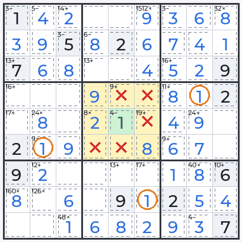

<!-- Written by tools/walkthrough.py calcudoku-killer: edit the script, not this page. -->
# Calcudoku Killer, step 45: the 1 in box 5

**Step 45 of 69** · [← Step 44](step-44.md) · [All steps](../calcudoku-killer.md#the-whole-puzzle-step-by-step) · [Step 46 →](step-46.md)

Box 5 needs a 1. r4c5 and r4c6: row 4 has one (r4c8). r5c6: column 6 has one (r8c6). r6c4 and r6c5: row 6 has one (r6c2). Only **r5c5** is left: **r5c5 = 1**.

**Step 45 of 69** · [← Step 44](step-44.md) · [All steps](../calcudoku-killer.md#the-whole-puzzle-step-by-step) · [Step 46 →](step-46.md)
