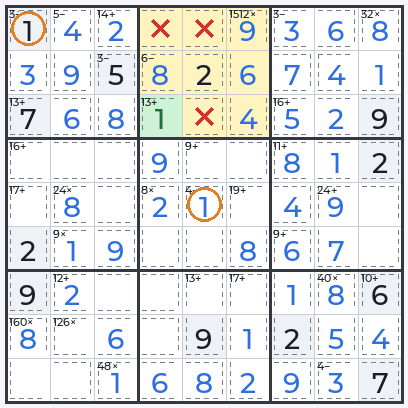

<!-- Written by tools/walkthrough.py calcudoku-killer: edit the script, not this page. -->
# Calcudoku Killer, step 46: the 1 in box 2

**Step 46 of 69** · [← Step 45](step-45.md) · [All steps](../calcudoku-killer.md#the-whole-puzzle-step-by-step) · [Step 47 →](step-47.md)

Box 2 needs a 1. r1c4 and r1c5: row 1 has one (r1c1). r3c5: column 5 has one (r5c5). Only **r3c4** is left: **r3c4 = 1**.

**Step 46 of 69** · [← Step 45](step-45.md) · [All steps](../calcudoku-killer.md#the-whole-puzzle-step-by-step) · [Step 47 →](step-47.md)
