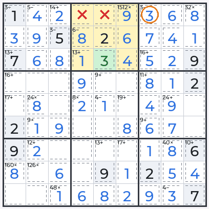

<!-- Written by tools/walkthrough.py calcudoku-killer: edit the script, not this page. -->
# Calcudoku Killer, step 47: the 3 in box 2

**Step 47 of 69** · [← Step 46](step-46.md) · [All steps](../calcudoku-killer.md#the-whole-puzzle-step-by-step) · [Step 48 →](step-48.md)

Box 2 needs a 3. r1c4 and r1c5: row 1 has one (r1c7). Only **r3c5** is left: **r3c5 = 3**.

**Step 47 of 69** · [← Step 46](step-46.md) · [All steps](../calcudoku-killer.md#the-whole-puzzle-step-by-step) · [Step 48 →](step-48.md)
