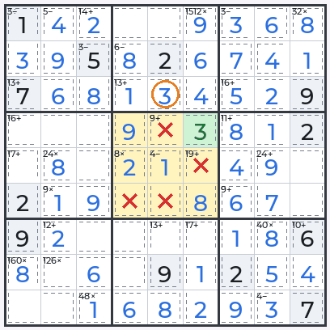

<!-- Written by tools/walkthrough.py calcudoku-killer: edit the script, not this page. -->
# Calcudoku Killer, step 48: the 3 in box 5

**Step 48 of 69** · [← Step 47](step-47.md) · [All steps](../calcudoku-killer.md#the-whole-puzzle-step-by-step) · [Step 49 →](step-49.md)

Box 5 needs a 3. r4c5 and r6c5: column 5 has one (r3c5). r5c6: the 19+ cage (with 4 and 8 already in it) needs 7 there. r6c4: the 8× cage (with 2 already in it) leaves 4 to make, and 3 doesn't go into it. Only **r4c6** is left: **r4c6 = 3**.

**Step 48 of 69** · [← Step 47](step-47.md) · [All steps](../calcudoku-killer.md#the-whole-puzzle-step-by-step) · [Step 49 →](step-49.md)
