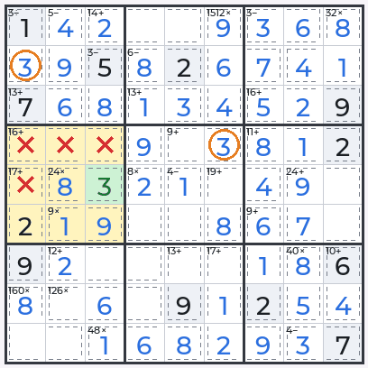

<!-- Written by tools/walkthrough.py calcudoku-killer: edit the script, not this page. -->
# Calcudoku Killer, step 49: the 3 in box 4

**Step 49 of 69** · [← Step 48](step-48.md) · [All steps](../calcudoku-killer.md#the-whole-puzzle-step-by-step) · [Step 50 →](step-50.md)

Box 4 needs a 3. r4c1, r4c2 and r4c3: row 4 has one (r4c6). r5c1: column 1 has one (r2c1). Only **r5c3** is left: **r5c3 = 3**.

**Step 49 of 69** · [← Step 48](step-48.md) · [All steps](../calcudoku-killer.md#the-whole-puzzle-step-by-step) · [Step 50 →](step-50.md)
